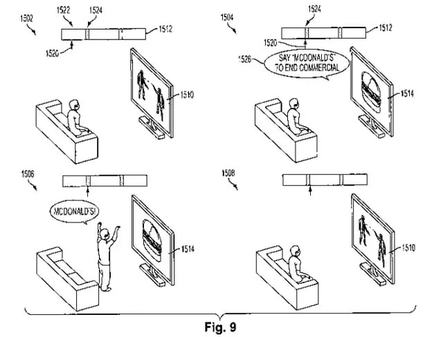
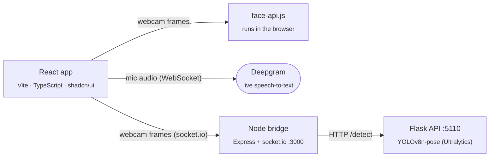

# Ad Dictator

**Ads you can't skip until you prove you were paying attention.** A joke project built at the Mashup hackathon (May 2025).

Sony holds a real patent, [US 8,246,454 B2](https://patents.google.com/patent/US8246454B2/en), *"System for converting television commercials into interactive networked video games"*. In one of its figures, the TV tells the viewer to stand up and shout "McDONALD'S!" to end the commercial. We thought it was too good to stay on paper, so for the sake of humour we built the product.

<p align="center">
  
  <br><sub>Fig. 9 of US 8,246,454 B2 (Sony). The inspiration.</sub>
</p>

Instead of a "Skip" button, Ad Dictator gives you a challenge, and it checks with your webcam or microphone that you actually did it. If you don't, the ad starts over. The landing page pitches it with a straight face, which is part of the joke.

## The demos

| Ad | Challenge | How it's checked |
|---|---|---|
| **McDonald's** | Smile at the camera for 3 seconds after the ad (15 s limit) | Facial expression recognition in the browser with face-api.js (tiny face detector + expression model) |
| **Temu** | Say "Temu" during the ad to end it early; otherwise raise a hand above your head when it ends (30 s limit) | Live speech-to-text over a WebSocket to Deepgram, with tolerant matching for common mis-transcriptions ("tee moo", "timu", …); body pose with YOLOv8-pose |
| **Fitness** | Raise a hand above your head | YOLOv8-pose keypoints: one arm with the elbow above the shoulder and the wrist above the elbow |

Pass the challenge and you get a reward video. Fail or time out and the ad restarts. The landing page also "sells" other uses: attention checks in online lessons, and comprehension questions before you can accept terms and conditions.

## How it works



- **Frontend:** React 18, TypeScript, Vite, Tailwind and shadcn/ui. The landing page was scaffolded with [Lovable](https://lovable.dev), and the detection features were written by hand on top.
- **Smile detection** runs entirely in the browser. The face-api.js model weights are served from `public/models/`.
- **Voice detection** streams microphone audio to Deepgram's real-time API and matches each transcript against the target phrase.
- **Pose detection** sends webcam frames through a small socket.io bridge to a Flask service. The service runs YOLOv8n-pose and checks the shoulder, elbow and wrist keypoints.

## Run it locally

```bash
npm install
cp .env.example .env.local          # add your Deepgram API key
npm run dev                         # http://localhost:8080
```

Pose detection needs two extra processes:

```bash
# 1. YOLO pose service (port 5110)
cd motionDetection
python -m venv venv && source venv/bin/activate
pip install -r requirements.txt
python pose_api.py

# 2. socket.io bridge (port 3000), from the repo root
npm run pose-server
```

## Repository

| Path | Contents |
|---|---|
| `src/components/DemoSection.tsx` | The ad player and the state machine for each challenge |
| `src/components/FacialRecognitionDemo.tsx` | Smile detection |
| `src/lib/voiceDetection.ts`, `src/components/VoiceDetectionDemo.tsx` | Deepgram streaming and phrase matching |
| `src/components/PoseDetectionDemo.tsx`, `pose-detection-server.cjs` | Pose detection client and bridge |
| `motionDetection/` | Flask + YOLOv8-pose service |
| `voiceDetection/` | Stand-alone Node prototype of the voice detector |
